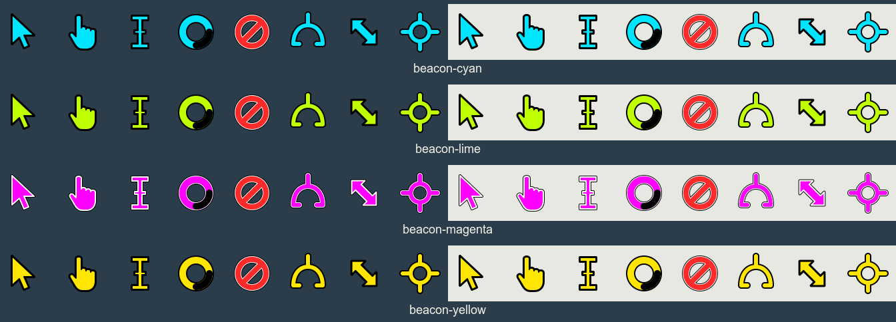
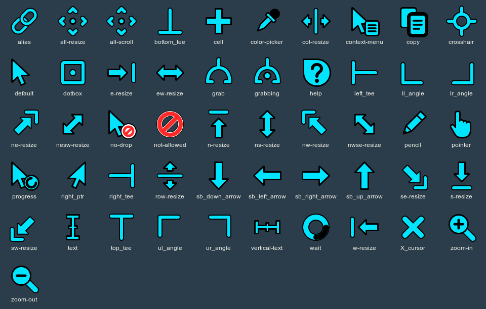
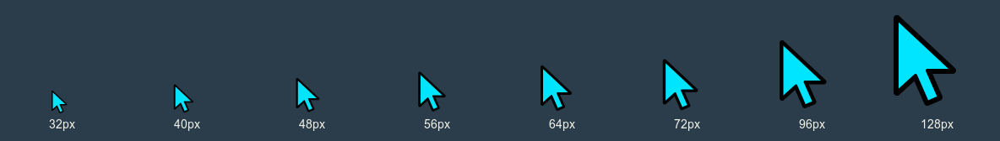
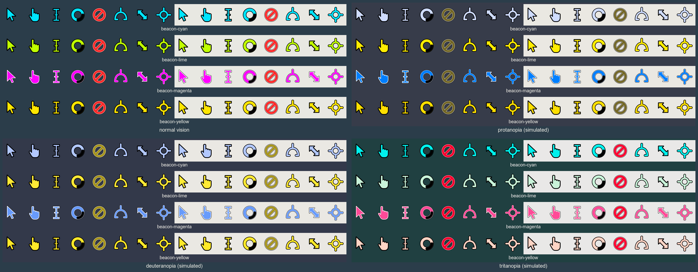

# xfce4-beacon-cursor-theme

[](https://gitlab.com/wamp3ter/xfce4-beacon-cursor-theme/-/pipelines)
[](https://gitlab.com/wamp3ter/xfce4-beacon-cursor-theme/-/releases)

High-visibility X11 cursor themes:
- each cursor is a saturated fill inside a black border;
- legible on both dark and light backgrounds.



> **Built with LLM assistance.** The scripts, cursor drawings and documentation
> in this repository were written with Claude (Anthropic) under the maintainer's
> direction.

Where it works:
- the themes are standard Xcursor, so they work on any X11 desktop;
- only the theme switch in `install.sh` is Xfce-specific.

Contents:
- [Quick start](#quick-start)
- [Themes](#themes)
- How-to guides
  - [Install](#install)
  - [Use on other desktops](#use-on-other-desktops)
  - [Uninstall](#uninstall)
  - [Add or change a palette](#add-or-change-a-palette)
  - [Change sizes or border width](#change-sizes-or-border-width)
  - [Edit a drawing](#edit-a-drawing)
  - [Add a cursor](#add-a-cursor)
  - [Check a change](#check-a-change)
  - [Regenerate the screenshots](#regenerate-the-screenshots)
  - [Make a release](#make-a-release)
- Reference
  - [Build settings](#build-settings)
  - [THEMES columns](#themes-columns)
  - [SHAPES columns](#shapes-columns)
  - [SVG placeholders](#svg-placeholders)
  - [Sizes](#sizes)
  - [Coverage](#coverage)
  - [Scripts](#scripts)
- Design notes
  - [Borders](#borders)
  - [Hotspots](#hotspots)
  - [Colour vision](#colour-vision)
- [Troubleshooting](#troubleshooting)
- [Licence](#licence)

## Quick start

Install the latest release, with nothing to build:

```
curl -fsSLO https://gitlab.com/wamp3ter/xfce4-beacon-cursor-theme/-/raw/main/install.sh
sh install.sh
```

- `install.sh` on its own downloads the latest release and installs every theme
  into `~/.icons`.
- It switches Xfce to `beacon-yellow`; pick another theme or size the same way as
  below.
- Needs `curl` and `tar`.

Or build from the repository:

```
git clone https://gitlab.com/wamp3ter/xfce4-beacon-cursor-theme.git
cd xfce4-beacon-cursor-theme
./build.sh
./install.sh
```

- `./build.sh` builds every theme into `build/`.
- `./install.sh` copies them into `~/.icons` and switches Xfce to `beacon-yellow`.
- Another theme or size: `BEACON_THEME=beacon-cyan BEACON_SIZE=40 ./install.sh`.
- Missing a build tool? See [Troubleshooting](#troubleshooting).

## Themes

| Theme | Fill | Border |
| --- | --- | --- |
| `beacon-yellow` | `#ffe600` | black |
| `beacon-lime` | `#c0ff00` | black |
| `beacon-cyan` | `#00e5ff` | black |
| `beacon-magenta` | `#ff00ff` | white + black |

In every theme:
- `not-allowed` and `no-drop` are red;
- `wait` and `progress` are animated, 12 frames each.



Sheets for the other themes:
- [yellow](screenshots/sheet-beacon-yellow.png)
- [lime](screenshots/sheet-beacon-lime.png)
- [magenta](screenshots/sheet-beacon-magenta.png)

## Install

### Requirements

- `rsvg-convert`, from librsvg
- `xcursorgen`, from the X.Org utilities
- a GNU userland (Linux); the scripts are not tested on BSD or macOS

Notes:
- Install them with your distribution's package manager; package names differ,
  so search for the two commands.
- `build.sh` checks for its tools before starting and lists any that are missing.

### Build and install

```
./build.sh
./install.sh
```

- `install.sh` copies every built theme into `~/.icons`; no root needed.
- It switches Xfce's cursor theme and size when `xfconf-query` is present.
- Otherwise it tells you to select the theme in your desktop's settings.
- See [Scripts](#scripts) for every option.

### Build in a container

With Docker, nothing else needs installing:

```
rm -rf build && docker build -o build .
./install.sh
```

- Remove `build/` first. See [Troubleshooting](#troubleshooting).
- Border widths: `--build-arg BORDER_IN=0.75 --build-arg BORDER_OUT=0.75`.

### System-wide

Copy the folders from `build/` into `/usr/share/icons/`.

## Use on other desktops

Copy the themes into `~/.icons`, then select one:
- **GNOME:** `gsettings set org.gnome.desktop.interface cursor-theme beacon-cyan`;
  size via the `cursor-size` key.
- **KDE Plasma and others:** the desktop's cursor settings.
- **Plain X11:** either
  - `Xcursor.theme: beacon-cyan` and `Xcursor.size: 48` in `~/.Xdefaults`; or
  - the `XCURSOR_THEME` and `XCURSOR_SIZE` environment variables.

## Uninstall

Switch to another cursor theme first, then remove every Beacon cursor theme:

```
xfconf-query -c xsettings -p /Gtk/CursorThemeName -s Adwaita
./install.sh --uninstall
```

Other themes in `~/.icons` are left alone, whatever their names.

## Add or change a palette

1. Add or edit a row in `THEMES` in `build.sh` (columns: [THEMES columns](#themes-columns)).
2. `./build.sh`.
3. [Check the change](#check-a-change), then install it.

Worked example, an orange theme:

1. Add the row to `THEMES`:

   ```
   beacon-orange  #ff7a1a #000000  #ff7a1a #000000
   ```

2. `./build.sh`. The new theme lands in `build/beacon-orange/`.
3. Check it, then `BEACON_THEME=beacon-orange ./install.sh`.


Choosing the inner ring:
- light fill: `#000000`, which merges with the black outer ring into one border;
- dark fill: `#ffffff`, giving a white ring inside the black one, as in
  `beacon-magenta`.

Not set per theme:
- `not-allowed` and `no-drop` keep their red, white and black everywhere;
- those colours are fixed in `src/not-allowed.svg` and `src/no-drop.svg`.

## Change sizes or border width

Sizes:
- edit `SIZES` in `build.sh`;
- more sizes mean larger files and a longer build;
- libXcursor uses the nearest size to the one requested.

Border width:
- set the variables for one build: `BORDER_IN=0.75 BORDER_OUT=0.75 ./build.sh`;
- see [Borders](#borders) for the trade-off.

## Edit a drawing

- Drawings are SVGs in `src/`, on a 32×32 `viewBox`.
- Edit them in a text editor, or in a vector editor that keeps the
  [placeholders](#svg-placeholders) intact.

Conventions every source follows:
- Draw each part three times, bottom to top:
  1. `@OUTER@` ring;
  2. `@INNER@` ring;
  3. `@FILL@` body.
- Strokes are centred on the edge, so the rings sit outside the fill.
- Draw directional shapes once, pointing up or to the top left, and let `@ROT@`
  turn them (resize arrows, tees, angles, `sb_` arrows).

## Add a cursor

1. Draw `src/<name>.svg`, following the [drawing conventions](#edit-a-drawing).
2. Add a row to `SHAPES` in `build.sh` (columns: [SHAPES columns](#shapes-columns)).
3. Rebuild, then check the hotspot by clicking a small target (see
   [Hotspots](#hotspots)).

## Check a change

- **All cursors at once:** `./previews.sh` regenerates the sheets; open
  `screenshots/sheet-<theme>.png`.
- **One application, before installing:** point libXcursor at the build folder
  and start one xterm with the theme, without touching the desktop:

  ```
  XCURSOR_PATH="$PWD/build:$HOME/.icons:/usr/share/icons" \
    XCURSOR_THEME=beacon-orange XCURSOR_SIZE=64 xterm
  ```

  Keep `XCURSOR_PATH`. See [Troubleshooting](#troubleshooting).
- **The whole desktop:** `BEACON_THEME=beacon-orange ./install.sh`.
- **Every cursor name present:** `./test.sh` (see [Scripts](#scripts)).

## Regenerate the screenshots

```
./previews.sh
```

- It rebuilds the themes and renders the images from the build's own frames.
- Exception: `example-orange.png` shows the worked example, which is not a shipped
  theme. To remake it:
  1. add the orange row;
  2. run `./previews.sh`;
  3. take the cursors from `screenshots/sheet-beacon-orange.png`.

## Make a release

1. Tag the commit with the release notes as the tag message:
   `git tag -a v1.0.0 -m "<release notes>"`.
2. Push the tag: `git push origin v1.0.0`.
3. CI then:
   - stops if the tag has no message;
   - builds the archive with `./dist.sh`;
   - uploads it to the project's package registry;
   - creates the release, with the tag message as its notes.

The Releases page is the changelog.

Every push also runs CI's check job: shellcheck, a full build and archive,
`./test.sh build`, then `./test-install.sh`.

To pack an archive locally: `./dist.sh`, which writes
`dist/xfce4-beacon-cursor-theme.tar.gz`.

## Build settings

All in `build.sh`:

- `THEMES`: table near the top. Names and colours of the themes built; default
  four themes. Columns: [THEMES columns](#themes-columns).

- `SHAPES`: table below `THEMES`. Which cursors exist, their drawing, hotspot and
  aliases. Columns: [SHAPES columns](#shapes-columns).

- `SIZES`: variable at the top. Pixel sizes packed into each cursor file.
  - Default: `32 40 48 56 64 72 96 128`.

- `FRAME_MS`: variable above `SHAPES`. Milliseconds per frame of `wait` and
  `progress`.
  - Default: `80`.

- `OUTER`: variable at the top. Outermost ring, shared by every theme.
  - Default: `#000000`.

- `BORDER_IN`: environment variable. Inner ring width, grid units.
  - Default: `0.5`.

- `BORDER_OUT`: environment variable. Outer ring width, grid units.
  - Default: `0.5`.

Grid units: drawings use a 32-unit grid, so 1 unit is 1.5 px at size 48.

## THEMES columns

Each row is one theme. Columns, in order:

1. Theme name, also the folder name in `~/.icons`.
   - letters, digits, `_`, `.` and `-`;
   - not starting with `.`;
   - any name works, not only `beacon-*`.
2. Fill for arrows, hands and every other non-text cursor.
3. Inner ring for those cursors.
4. Fill for `text` and `vertical-text`.
5. Inner ring for `text` and `vertical-text`.

Rules:
- colours are `#rrggbb`;
- `build.sh` checks every name and colour and stops on the first bad one,
  leaving the previous `build/` in place.

## SHAPES columns

```
<cursor-name>  <source>  <rotation>  <frames>  <hotspot-x>  <hotspot-y>  [aliases...]
```

- `cursor-name`: the file name in `cursors/`, normally a CSS cursor name.
- `source`: the SVG's name without `.svg`; several rows can share one.
- `rotation`: degrees applied through `@ROT@`; `0` if unused.
- `frames`:
  - `1` for a static cursor;
  - more to animate through `@SPIN@`, at `FRAME_MS` per frame.
- `hotspot-x`, `hotspot-y`: the click point.
  - whole grid units from the top-left corner of the 32×32 grid;
  - measured on the rotated drawing.
- `aliases`: other names that point to this cursor, created as symlinks.

## SVG placeholders

`build.sh` substitutes these per theme and frame:

| Placeholder | Replaced with |
| --- | --- |
| `@FILL@` | the theme's fill |
| `@INNER@` | the theme's inner ring colour |
| `@OUTER@` | `OUTER` |
| `@ROT@` | the row's rotation in `SHAPES`, in degrees |
| `@SPIN@` | the frame's rotation for animated cursors, 0 to 360 |
| `{O}`, `{I}` | stroke widths for the outer and inner ring |
| `{w+O}`, `{w+I}` | the same, plus `w` units, for line art drawn `w` units wide |

## Sizes

- Built at 32, 40, 48, 56, 64, 72, 96 and 128 px.
- Any other requested size resolves to the nearest built size.



How applications pick up the size:
- GTK applications, Firefox included: follow Xfce's theme and size, live.
- xterm and other plain X11 applications: `Xcursor.size` in `~/.Xdefaults`, or
  `XCURSOR_SIZE`.

## Coverage

- **Adwaita:** every cursor name it ships, with its aliases.
- **Additional aliases:** `dnd-copy`, `dnd-link`, `dnd-no-drop`, and `size_all`
  (Qt's move cursor).
- **Legacy X11 names:** the set DMZ-White ships, following DMZ's choices.
  - Drawn: the four tees and angles, the `sb_` arrows, `right_ptr`, `dotbox`,
    `pencil`, `color-picker`.
  - Aliased: `up_arrow`, `left_ptr_watch`, `circle`, `plus`, `pirate` and others.
  - Omitted: DMZ's hex-named aliases, used only by Qt 4-era applications.
- **Fallback:** any other name resolves through Adwaita (`Inherits=Adwaita`).
  - This needs Adwaita's cursor theme installed (usually in an
    `adwaita-icon-theme` package).
  - Without it, an unlisted name falls back to the plain X11 cursor.

The `SHAPES` table in `build.sh` lists every name and alias.

## Scripts

- `./build.sh`: builds every theme into `build/`.
  - Checks for its tools before starting.
  - Builds into `build.new/` and replaces `build/` only when every theme built,
    so a failed build leaves the previous one in place.

- `./install.sh`: copies every theme into `~/.icons` and switches Xfce to one.
  - `~/.icons` is the only per-user directory libXcursor searches (libXcursor 1.2
    checked).
  - Where the themes come from:
    - `build/` next to the script: a repository after `./build.sh`, or an
      unpacked release;
    - a repository without `build/`: it stops and asks for `./build.sh`;
    - the script on its own: it downloads the latest release into a temporary
      folder, installs from it, and removes the folder;
    - it never builds.
  - `BEACON_THEME`: theme to switch to; default `beacon-yellow`.
  - `BEACON_SIZE`: cursor size; default `48`.
  - `BEACON_URL`: another release archive to download.
  - Checks everything before changing anything: `BEACON_THEME` must be among the
    themes being installed, `BEACON_SIZE` must be a number, and no destination
    may be a same-named folder that `build.sh` did not create.
  - Copies each theme beside the old one, then swaps it in, so a failed copy
    leaves the old theme in place.

- `./install.sh --uninstall`: removes every Beacon cursor theme from `~/.icons`.
  - Removes only folders `build.sh` created; it checks a marker line in each
    `index.theme`.

- `./previews.sh`: regenerates the images in `screenshots/`.
  - Needs ImageMagick in addition to the build tools; checks for its tools before
    starting.

- `./dist.sh`: builds, then packs a release archive.
  - Packs the built themes, `install.sh`, README and both licences.
  - Writes `dist/xfce4-beacon-cursor-theme.tar.gz`.
  - Unpacked, its `install.sh` works as in the repository.

- `./test.sh [dir]`: checks that every theme has every cursor name and alias in
  `SHAPES`.
  - No argument: first builds with `docker build` into a fresh `build.test/`,
    leaving `build/` alone; needs Docker.
  - `dir`: checks the themes already built there, for example `./test.sh build`;
    no Docker.

- `./test-install.sh`: tests `install.sh` in every mode, without touching your
  desktop.
  - Run `./dist.sh` first; it tests against `build/` and the local archive.
  - Each case gets a throwaway HOME, and a stub `xfconf-query` that only records
    its arguments.
  - Downloads come from the local archive (`file://`), never the network.
  - Cases: repo with and without `build/`, the script on its own, a bad URL,
    `BEACON_THEME` and `BEACON_SIZE`, a same-named folder that is not a Beacon
    theme, `--uninstall`.
  - CI runs it on every push.

## Borders

- The black border carries the contrast, so a cursor reads on any background.
- Wider borders read better on busy backgrounds, but cover more of what is under
  the pointer.

## Hotspots

Where the click point goes:
- pointers: the tip;
- one-way resize arrows: just inside the arrowhead, 1.5 units behind the tip;
- two-way arrows and centred symbols: the centre, `16 16`.

## Colour vision



Method:
- simulated protanopia, deuteranopia and tritanopia;
- Machado, Oliveira and Fernandes 2009, full severity;
- the model is less reliable for tritanopia.

Results:
- **Visibility:** every theme stays visible for all three.
  - The black border carries the contrast: 12:1 or more against the yellow, lime
    and cyan fills.
- **Yellow vs lime:** indistinguishable with red-green colour blindness; this only
  affects choosing between them.
- **Red cursors:** `not-allowed` and `no-drop` appear olive with red-green colour
  blindness; their circle-slash shape still identifies them.

## Troubleshooting

### Removed themes are still in `build/` after a container build

- Cause: `docker build -o build` adds to `build/` instead of replacing it.
- Fix: `rm -rf build` before `docker build`.

### `build.sh` stops and lists missing tools

- Cause: a build tool is not installed.
- Fix: install it (see [Requirements](#requirements)), or
  [build in a container](#build-in-a-container).

### `XCURSOR_THEME` has no effect when testing a build

- Cause: without `XCURSOR_PATH`, `XCURSOR_THEME` finds only installed themes.
- Fix: put the build folder in `XCURSOR_PATH`, as in
  [Check a change](#check-a-change).

## Licence

Copyright 2026 Wampeter Foma. Two licences, by kind of file:

| What | Licence | Text |
| --- | --- | --- |
| Code: the shell scripts, `Dockerfile` and `.gitlab-ci.yml` | AGPL-3.0-only | `LICENSE` |
| Artwork: the cursor drawings in `src/`, the `index.theme` template, the cursor themes `build.sh` produces, and `screenshots/` | CC BY-NC-SA 4.0 | `LICENSE-ART` |

Each file names its licence in an `SPDX-License-Identifier` line.

The artwork licence:
- allows sharing and adapting with credit, under the same licence, for
  non-commercial use;
- commercial use (selling the themes, or bundling them in a paid product) needs
  the copyright holder's permission: open an issue on the repository;
- because of the non-commercial term, distributions that require free licences
  (Debian, Fedora) cannot package the artwork without that permission.
